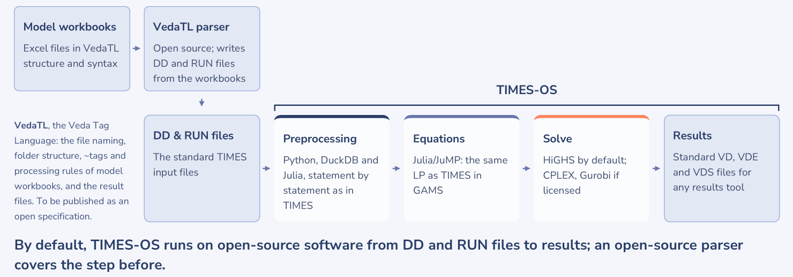

# TIMES Open Stack (TIMES-OS)

[](https://github.com/kanors-emr/TIMES-OS/blob/main/LICENSE)

An open-source MIRROR of TIMES, the energy system model generator of IEA-ETSAP. The mirror is the `main` branch. It
follows the official TIMES and adds nothing of its own, and its promise is open use: the model TIMES in GAMS gives,
running on your machine with no surprises in getting it there.

TIMES itself goes on being developed where it always has been, in GAMS, under IEA-ETSAP, and that is expected to
continue. This mirror is alive. `main` follows that work, and each official release of TIMES is taken into it. Today
that is v4.9.8.

That discipline belongs to `main` alone. The repository is also a complete TIMES in Python and Julia, open under the
GPL, and a fork of it is a sound place to begin independent work, wherever that work leads and however far from TIMES.

## What it is

TIMES-OS runs TIMES models from their standard input files, the DD and RUN files, to results on open-source software
alone. It builds the same linear program as TIMES in GAMS, verified coefficient by coefficient, solves it with HiGHS (or
with CPLEX, Gurobi or MOSEK where you have a licence), and writes the Veda result files. A model that needs a feature
TIMES-OS does not have stops before anything is solved, and the report lists everything the model needs. Same input
files, same LP, same output formats.

It covers core TIMES and its main extensions, 381 of the 452 input attributes TIMES uses
([`FEATURES.md`](https://github.com/kanors-emr/TIMES-OS/blob/main/FEATURES.md)). Not yet supported: endogenous technology learning (ETL), the IER extension, damage
costs other than with `DAMAGE NO`, and MACRO other than its linearised form (MLF). Verified on 17 cases of 9 open models, up to 8.2 million rows:
[the evidence](https://github.com/kanors-emr/TIMES-OS-models).



    DD files --times_pp (Python, DuckDB)--> tables --times_eq (Julia/JuMP)--> HiGHS --times_rpt (Python)--> Veda result files

The DD and RUN files are written from the model workbooks by Veda or by another VedaTL parser (VedaTL, the Veda Tag
Language, is how TIMES model workbooks are written).

## Quick start

You need **Python 3.11 or newer**; `setup` installs the rest, Julia included. Windows is the main platform; Linux
works too.

```
git clone https://github.com/kanors-emr/TIMES-OS
cd TIMES-OS
python TIMES.py setup
python TIMES.py run <run folder>
```

- `setup` installs Julia when none of 1.11 or newer is found (an older one is left as it is; on Windows through
  winget or the Microsoft Store; on any system as a portable copy from julialang.org, no administrator rights
  needed), installs the Python and Julia packages into this folder, compiles the Julia code and runs the example
  model. Allow ten to fifteen minutes the first time.
- **Julia's packages and their compiled code stay in this folder** (`.julia_depot`, a few GB), beside the rest of
  TIMES-OS; Julia's usual store in your home folder (`~/.julia`, on Windows on drive C:) is not used, so a full C:
  drive does not stop a TIMES-OS installed on another drive, and deleting the folder removes all of it. If you use
  Julia for other work too and would rather keep one store for all of it, `setup --julia-depot <folder>` puts it
  there (your existing depot, or a shared one); setup keeps that choice for the runs and for the next setup. A
  `JULIA_DEPOT_PATH` already set when setup first runs is taken the same way.
- Stochastic models (`$SET STAGES YES` or `$SET SPINES YES`): their equations compiled ahead are a package of their
  own, which `setup` compiles with the rest. Where it is missing or out of date, the first run of such a model
  compiles it (a few minutes, once; the run says so).
- No git? Download the repository as a ZIP from GitHub instead of `git clone`.
- A **run folder** holds one model run: the run file (`<case>.run`) and its DD files. `python TIMES.py example demo`
  copies the example model, DemoS_012, into a new folder `demo`, to try it with `python TIMES.py run demo`.
- The result is `runs/<case>/report_<case>.txt`; `--out <folder>` puts the results elsewhere. The last line of a run
  is `Output files available here: <folder>`. **The report's first line is the verdict**: `SOLVED`, `UNSUPPORTED`
  (with the list of what is missing), `NOT SOLVED`, `INFEASIBLE` or `ERROR`. A block TIME AND MEMORY follows the
  opening lines: the time to the solver and the peak memory, and, when the run ran GAMS, GAMS's and the ratio. A run
  that solves nothing (`--no-solve`) shows the time to the built model instead, beside GAMS's time to the start of
  CONVERT when GAMS ran with `--no-solve` too.
- Options you give to every run can go in a settings file, `times-os.toml`, beside your run folders or in your home
  folder (`python TIMES.py config` shows what is in force); see the [user guide](https://github.com/kanors-emr/TIMES-OS/blob/main/docs/user-guide.md#a-settings-file-for-the-options-of-run-times-ostoml).
- Every commit on `main` is a release, checked against TIMES in GAMS before it is published, on a set of cases that
  uses every feature of the open reference models, including at least one large model (all of them are checked every
  month): take `main` or a tagged release, with nothing to build or check yourself. With GAMS on the machine (`setup` then fetches the TIMES source),
  `--check` makes the same comparison on your own model ([verification](https://github.com/kanors-emr/TIMES-OS/blob/main/docs/verification.md)).
  The comparison has been run with GAMS 54.1.0; with an older GAMS, `check` and a run with `--check` say so in one
  line, and the run goes on. A run uses GAMS only when asked (`--check`, `--gams run` or `reuse`, `verify`): a GAMS
  listing in the run folder is compared with only with `--gams reuse`.

Everything else (options, results, the extensions, runs that read an earlier run) is in the
[user guide](https://github.com/kanors-emr/TIMES-OS/blob/main/docs/user-guide.md).

## Installing with pip (beta)

TIMES-OS can also be installed as a Python package. In this release that is a beta feature, offered to those
willing to help test it: if you are, we would be glad to hear how it goes. Until a release makes it a regular
feature, the clone above is the way to install for everyone else.

```
pip install times-os
times-os example demo
times-os run demo
```

- **The first run sets TIMES-OS up**, once, and says so before it starts: it installs Julia when none of 1.11 or
  newer is found, installs and compiles the Julia packages, and runs the example model as its test. It needs an
  internet connection, about 8 GB of memory and some time: Julia compiles its packages, from ten minutes on a fast
  machine to over an hour on a small one. Its log is in TIMES-OS's data folder (`times-os check` shows where).
  `times-os setup` does the same beforehand.
- `python -m times_os ...` is the same command and always works, also where `times-os` is not on the PATH (on Windows,
  a Python installed for one user often leaves its `Scripts` folder off the PATH).
- The results go to `times-os-runs\<case>\` in the folder that holds the run folder (`C:\models\MyCase` gives
  `C:\models\times-os-runs\MyCase\`), wherever you run from; several cases share one `times-os-runs`, in the
  lowest folder that holds them all, with `summary.txt`. `--out <folder>` puts them elsewhere.
- The settings file `times-os.toml` and `times-os config` work as from a clone.
- **Update:** `pip install -U times-os`; the next run brings the setup up to date (and says so). **Remove:**
  `times-os clean` (it lists what TIMES-OS keeps in its data folder and asks before removing it), then
  `pip uninstall times-os`.
- For the comparison with TIMES in GAMS (`--check`), `--lp` and `--jacobian`: `pip install "times-os[gdx]"`; for
  `--gurobi`: `pip install "times-os[gurobi]"`; for `--mosek` (MOSEK through Julia): `times-os setup --mosek`.
- **Where it has run:** this release's package has been installed and run, first run and second, on Windows and
  Linux on GitHub's runners and on a Windows workstation of KanORS-EMR; on macOS, an earlier version of it has.
- **Tell us what you find**, whatever it is: in the repository's [Issues](https://github.com/kanors-emr/TIMES-OS/issues),
  or by email to times-os@kanors.com. `times-os --version` and `times-os check` name both.

Everything in the [user guide](https://github.com/kanors-emr/TIMES-OS/blob/main/docs/user-guide.md) holds for the package too, with `times-os <command>` for
`python TIMES.py <command>`.

## What this enables

- **TIMES with open-source software only.** A TIMES model runs from its input files to its results with no
  proprietary software, as funders of research increasingly require.
- **TIMES with no licence to start.** Students, universities and government teams can run TIMES models, and teach
  with them, without a software licence.
- **No disruption.** Keep developing where you work today, and deliver on open source: the same files in, the same
  model and results out as TIMES in GAMS, which stays the reference. The engines are fully swappable.

## Documentation

| Document | What it covers |
|---|---|
| [User guide](https://github.com/kanors-emr/TIMES-OS/blob/main/docs/user-guide.md) | Installing and running; the verdicts; results and result folders; every option; the model reduction; runs that read an earlier run; TIMES-MACRO (MLF); stochastic runs |
| [Verification](https://github.com/kanors-emr/TIMES-OS/blob/main/docs/verification.md) | How agreement with TIMES in GAMS is checked; comparing a model of your own, step by step; the open reference models |
| [`FEATURES.md`](https://github.com/kanors-emr/TIMES-OS/blob/main/FEATURES.md) | Every TIMES input attribute and whether it is supported |
| [Scope and commitments](https://github.com/kanors-emr/TIMES-OS/blob/main/docs/scope-and-commitments.md) | What `main` follows; what is taken on it; KanORS-EMR's commitments for submitted models |
| [`CHANGELOG.md`](https://github.com/kanors-emr/TIMES-OS/blob/main/CHANGELOG.md) | What each version brings |
| [Feature models](https://github.com/kanors-emr/TIMES-OS/blob/main/models/README.md) | Small models bundled here, each showing a TIMES feature, with their published results; `setup` runs one as its test |
| [Open reference models](https://github.com/kanors-emr/TIMES-OS-models) | The evidence: seventeen cases of nine open models, up to 8.2 million rows, with the results of TIMES in GAMS |
| [How TIMES-OS came about](https://github.com/kanors-emr/TIMES-OS/blob/main/docs/the-story-of-times-os.md) | The story behind TIMES-OS |

## Contributing and support

Reports of models that do not run, or do not agree with TIMES in GAMS, are the most useful contribution: run the
model with `--bundle` and open an issue with its report. A model that cannot be public can be sent in confidence.
Details, and how changes are taken: [`CONTRIBUTING.md`](https://github.com/kanors-emr/TIMES-OS/blob/main/CONTRIBUTING.md).

## How it is built

TIMES-OS is written by AI. Claude (Anthropic) wrote the code; Dr Amit Kanudia, one of the original authors of TIMES,
decides what is built, in what order, and when it is done. Each part follows the matching GAMS statement of TIMES,
quoted above the code that implements it, and is finished only when TIMES-OS builds the same model as TIMES in GAMS.

## Related projects

[TIMES.jl](https://github.com/esma-ie/TIMESjl) (ESMA): a translation of TIMES to Julia/JuMP, in development.

## Licence and credits

GPL-3.0-or-later, the licence of TIMES. TIMES is developed and maintained by IEA-ETSAP; this is an independent
project of KanORS-EMR and not an ETSAP product. Who wrote TIMES and TIMES-OS: [`AUTHORS.md`](https://github.com/kanors-emr/TIMES-OS/blob/main/AUTHORS.md). Details in
[`NOTICE.md`](https://github.com/kanors-emr/TIMES-OS/blob/main/NOTICE.md). How to cite it: [`CITATION.cff`](https://github.com/kanors-emr/TIMES-OS/blob/main/CITATION.cff). Conduct:
[`CODE_OF_CONDUCT.md`](https://github.com/kanors-emr/TIMES-OS/blob/main/CODE_OF_CONDUCT.md).
