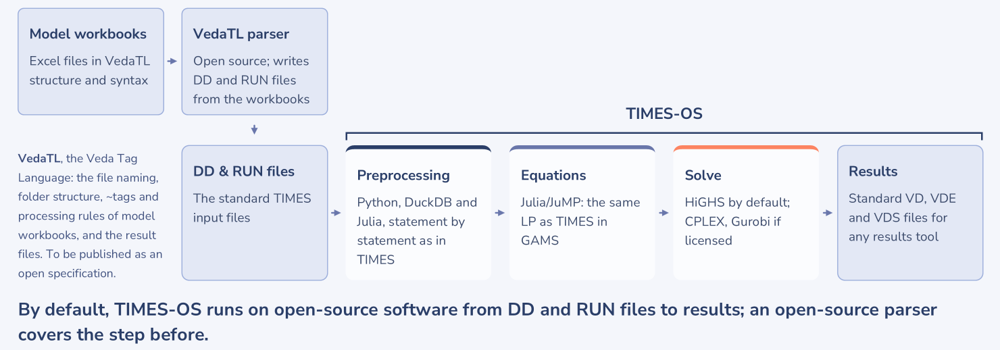

# TIMES Open Stack (TIMES-OS)

[](LICENSE)

An open-source implementation of TIMES, the energy system model generator of IEA-ETSAP.

## What it is

TIMES-OS runs TIMES models from their standard input files, the DD and RUN files, to results on open-source software
alone. It mirrors TIMES v4.9.8, the current official release: it builds the same linear program as TIMES in GAMS,
verified coefficient by coefficient, solves it with HiGHS (or with CPLEX or Gurobi where you have a licence), and
writes the Veda result files. A model that needs a feature TIMES-OS does not have stops before anything is solved,
and the report lists everything the model needs. Same input files, same LP, same output formats.

It covers core TIMES and its main extensions, 380 of the 452 input attributes TIMES uses
([`FEATURES.md`](FEATURES.md)). Not yet supported: endogenous technology learning (ETL), the IER extension, damage
costs, and MACRO other than its linearised form (MLF). Verified on 17 cases of 9 open models, up to 8.2 million rows:
[the evidence](https://github.com/kanors-emr/TIMES-OS-models).



    DD files --times_pp (Python, DuckDB)--> tables --times_eq (Julia/JuMP)--> HiGHS --times_rpt (Python)--> Veda result files

The DD and RUN files are written from the model workbooks by Veda or by another VedaTL parser (VedaTL, the Veda Tag
Language, is how TIMES model workbooks are written).

## Quick start

You need **Python 3.11 or newer**; `setup` installs the rest, Julia included. Windows is the main platform; Linux
works too.

```
git clone https://github.com/kanors-emr/TIMES-OS
cd TIMES-OS
python TIMES.py setup
python TIMES.py run <run folder>
```

- `setup` installs Julia if none is found (on Windows through winget or the Microsoft Store; on any system as a
  portable copy from julialang.org, no administrator rights needed), installs the Python and Julia packages into
  this folder, compiles the Julia code and runs the example model. Allow ten to fifteen minutes the first time.
- Stochastic models (`$SET STAGES YES` or `$SET SPINES YES`): their equations compiled ahead are a package of their
  own, which `setup` compiles with the rest. Where it is missing or out of date, the first run of such a model
  compiles it (a few minutes, once; the run says so).
- No git? Download the repository as a ZIP from GitHub instead of `git clone`.
- A **run folder** holds one model run: the run file (`<case>.run`) and its DD files.
- The result is `runs/<case>/report_<case>.txt`. **Its first line is the verdict**: `SOLVED`, `UNSUPPORTED` (with the
  list of what is missing), `NOT SOLVED`, `INFEASIBLE` or `ERROR`.
- Every commit on `main` is a release, checked against TIMES in GAMS before it is published: take `main` or a tagged
  release, with nothing to build or check yourself. With GAMS on the machine (`setup` then fetches the TIMES source),
  `--check` makes the same comparison on your own model ([verification](docs/verification.md)).

Everything else (options, results, the extensions, runs that read an earlier run) is in the
[user guide](docs/user-guide.md).

## What this enables

- **TIMES with open-source software only.** A TIMES model runs from its input files to its results with no
  proprietary software, as funders of research increasingly require.
- **TIMES with no licence to start.** Students, universities and government teams can run TIMES models, and teach
  with them, without a software licence.
- **No disruption.** Keep developing where you work today, and deliver on open source: the same files in, the same
  model and results out as TIMES in GAMS, which stays the reference. The engines are fully swappable.

## Documentation

| Document | What it covers |
|---|---|
| [User guide](docs/user-guide.md) | Installing and running; the verdicts; results and result folders; every option; the model reduction; runs that read an earlier run; TIMES-MACRO (MLF); stochastic runs |
| [Verification](docs/verification.md) | How agreement with TIMES in GAMS is checked; comparing a model of your own, step by step; the open reference models |
| [`FEATURES.md`](FEATURES.md) | Every TIMES input attribute and whether it is supported |
| [Scope and commitments](docs/scope-and-commitments.md) | What `main` follows; what is taken on it; KanORS-EMR's commitments for submitted models |
| [`CHANGELOG.md`](CHANGELOG.md) | What each version brings |
| [Feature models](models/README.md) | Small models bundled here, each showing a TIMES feature, with their published results; `setup` runs one as its test |
| [Open reference models](https://github.com/kanors-emr/TIMES-OS-models) | The evidence: seventeen cases of nine open models, up to 8.2 million rows, with the results of TIMES in GAMS |
| [How TIMES-OS came about](docs/the-story-of-times-os.md) | The story behind TIMES-OS |

## Contributing and support

Reports of models that do not run, or do not agree with TIMES in GAMS, are the most useful contribution: run the
model with `--bundle` and open an issue with its report. A model that cannot be public can be sent in confidence.
Details, and how changes are taken: [`CONTRIBUTING.md`](CONTRIBUTING.md).

## How it is built

TIMES-OS is written by AI. Claude (Anthropic) wrote the code; Dr Amit Kanudia, one of the original authors of TIMES,
decides what is built, in what order, and when it is done. Each part follows the matching GAMS statement of TIMES,
quoted above the code that implements it, and is finished only when TIMES-OS builds the same model as TIMES in GAMS.

## Related projects

[TIMES.jl](https://github.com/esma-ie/TIMESjl) (ESMA): a translation of TIMES to Julia/JuMP, in development.

## Licence and credits

GPL-3.0-or-later, the licence of TIMES. TIMES is developed and maintained by IEA-ETSAP; this is an independent
project of KanORS-EMR and not an ETSAP product. Who wrote TIMES and TIMES-OS: [`AUTHORS.md`](AUTHORS.md). Details in
[`NOTICE.md`](NOTICE.md). How to cite it: [`CITATION.cff`](CITATION.cff). Conduct:
[`CODE_OF_CONDUCT.md`](CODE_OF_CONDUCT.md).
