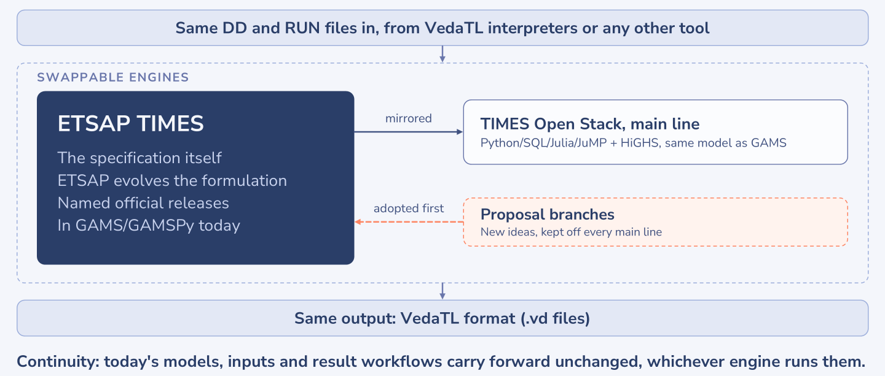

# Scope and commitments

Why TIMES-OS exists, what `main` follows, what is taken on it, and what KanORS-EMR commits to.

## Purpose

TIMES-OS has one purpose: to let the TIMES community run TIMES on open-source software today, from the files it
already has. It meets two needs: eligibility for projects that require open tools, and outreach to newcomers, who can
start with TIMES at no cost. It serves the users of TIMES and asks nothing new of them.

## Openness with a purpose

TIMES-OS is released the way IEA-ETSAP releases TIMES: the source of a tested version, from a maintainer who answers
when something is wrong. TIMES users have relied on that for thirty years. TIMES-OS adds the evidence: open reference
models published with the results of TIMES in GAMS ([TIMES-OS-models](https://github.com/kanors-emr/TIMES-OS-models)),
and the check every release passes, which anyone with GAMS can run on a model of their own
([verification](verification.md)).

Keeping TIMES-OS in agreement with TIMES in GAMS is the maintainers' work. Everyone else needs no GAMS: those who run
TIMES-OS take a release, and those who build on it start from a complete TIMES in Python and Julia, free to take it
wherever their work leads.

## One TIMES, swappable engines

TIMES in GAMS, maintained under IEA-ETSAP, remains the reference. ETSAP keeps authority over the formulation and its
releases. The `main` branch of TIMES-OS mirrors a declared official TIMES release, today v4.9.8, and adds no
formulation of its own. The community keeps one TIMES, along with thirty years of validation; the engine becomes a
choice, and the model stays the same.

## What `main` follows

KanORS-EMR maintains `main` with one commitment: to bring it ever closer to the official TIMES, as released by
IEA-ETSAP. Everything on `main` follows TIMES v4.9.8; features TIMES does not have are not added to it, and where the
two differ, TIMES is right. When ETSAP releases a new version, `main` moves to it. New ideas belong in TIMES first, and in
the mirror after; a pull request that departs from official TIMES, however slightly, is declined.

Experiments are welcome on forks. Forks, branches and other work built on this code are their authors' own; the
licence allows them and KanORS-EMR is not responsible for them. Reports of models that do not run or do not agree are
welcome, and the features real models need weigh in what is done next. How to bring a report, a model or a change:
[`CONTRIBUTING.md`](../CONTRIBUTING.md).

## Commitments for models submitted by 31 December 2026

**The engine.** If you submit DD and RUN files that TIMES-OS processes differently from TIMES v4.9.8, whether it
builds a different model or stops on a feature it does not yet support, KanORS-EMR will enhance TIMES-OS until it
builds the same model.

**The workbooks.** An open-source VedaTL parser turns model workbooks into DD and RUN files. Where it does not yet
handle a model out of the box, the modeller can close the gap, because it is open source, or its caretakers can. If neither works for a model needed in a funded project, KanORS-EMR will make that model run through
it.

**Confidentiality.** Submissions are treated in full confidence. A reduced sample that reproduces the issue, with
sensitive data removed, is all that is needed and is the best way to send one. How to send it: [`CONTRIBUTING.md`](../CONTRIBUTING.md).

These commitments are KanORS-EMR's alone. Beyond them, no timeline is promised, and work needed by a date is
commissioned work: write to KanORS-EMR.

## Independence

TIMES-OS is an independent project of KanORS-EMR. It is not an ETSAP project: ETSAP neither commissioned nor
funded it.
